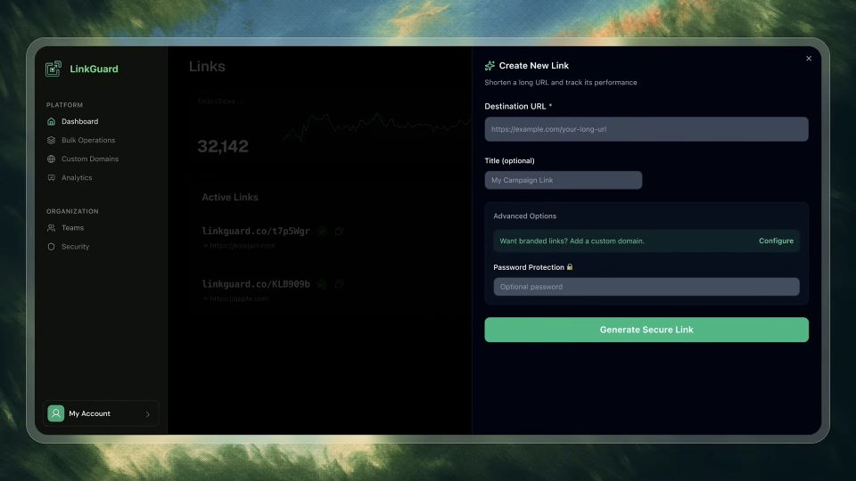
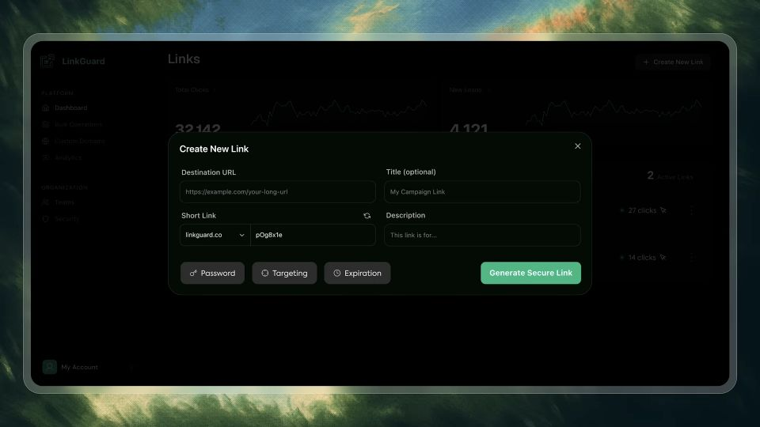

# Separate the core form from optional controls

Based on Kole Jain’s UX/UI tutorials. These are unofficial, AI-assisted study notes and adapted skills; they were not written, approved or endorsed by Kole Jain. Permission has not been obtained from him.

The source videos, narration and source-frame excerpts remain the content of Kole Jain and any other respective rights holders. They are not licensed by this project.

Source-video comparison, not a controlled usability experiment.

[Kole Jain — 5 SaaS UI/UX mistakes that SCREAM you Vibe Code](https://www.youtube.com/watch?v=PDcQJOPby1k)

## Problem shown · 2:09

Destination and title fields share the drawer with an expanded Advanced Options block and password input.

[Open public image](https://brianjmeier.github.io/design-fieldnotes/assets/examples/form-problem-129.jpg) · [Source moment](https://www.youtube.com/watch?v=PDcQJOPby1k&t=129s)

## Change shown · 2:25

The link list remains behind the modal. Short-link and description fields are added; optional configuration is represented by compact actions.

[Open public image](https://brianjmeier.github.io/design-fieldnotes/assets/examples/form-revision-145.jpg) · [Source moment](https://www.youtube.com/watch?v=PDcQJOPby1k&t=145s)

## Problem

The creation drawer displays an expanded advanced-options block beside destination and title fields.

## Observed change

The dialog is centered over the link list, adds short-link and description fields, and presents Password, Targeting and Expiration as separate actions.

## Interpreted mechanism

Optional controls occupy less initial space, making the main link details easier to distinguish.

## Transfer when

Optional settings are uncommon and can be opened without losing entered data.

## Limits and counterexamples

The revision adds fields, changes container and grouping, and alters styling. A centered modal is not inherently better than a drawer. Required settings must remain visible; long or resumable tasks may need a page.

## Unverified outcomes

The stills do not verify what the optional actions open, keyboard focus, validation, completion time or mobile behavior.

## Provenance

Browser screenshot of the full 960 × 540 official embedded player, sought with the documented YouTube IFrame API; paused, player controls hidden. No video file download or image retouching.

Captured 2026-10-09. No image edits. Source annotations and any subtitles remain part of the excerpt.

[Source-material rights](../SOURCE-MATERIAL.md)

Use a vision-capable image tool to load both local images or public image URLs. Text links and alt text alone do not provide the visual evidence.
