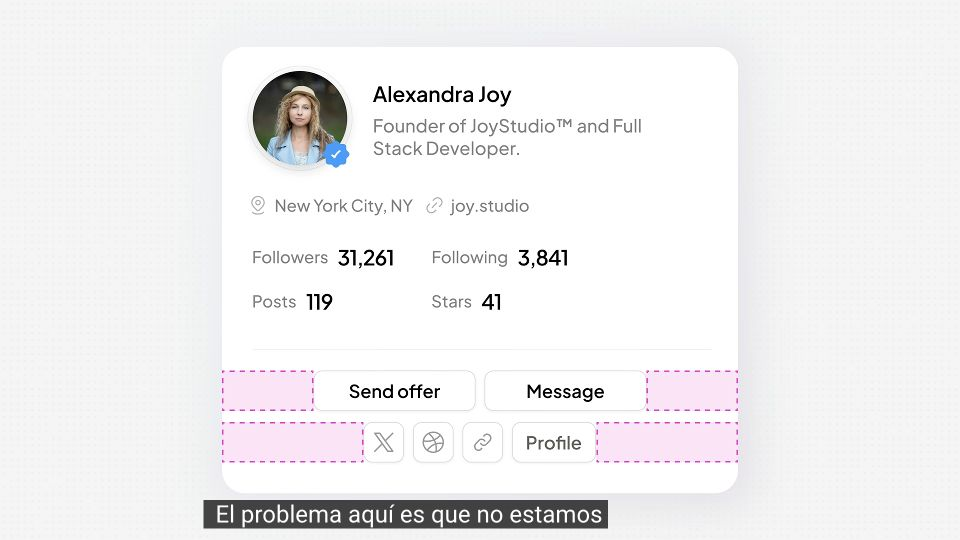
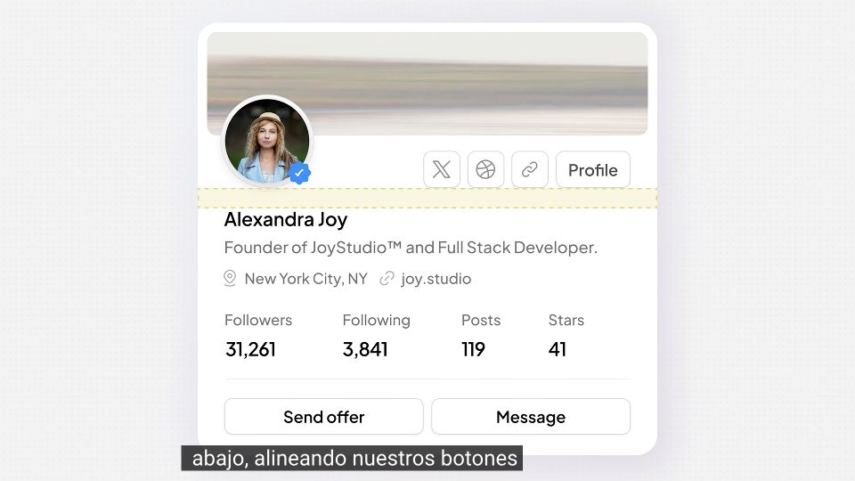

# Give profile content shared edges

Based on Kole Jain’s UX/UI tutorials. These are unofficial, AI-assisted study notes and adapted skills; they were not written, approved or endorsed by Kole Jain. Permission has not been obtained from him.

The source videos, narration and source-frame excerpts remain the content of Kole Jain and any other respective rights holders. They are not licensed by this project.

Source-video comparison, not a controlled usability experiment.

[Kole Jain — The secret behind weirdly perfect UI designs](https://www.youtube.com/watch?v=neE6wOuBIP8)

## Problem shown · 0:55

Primary and secondary action rows have different widths. Pink callouts are in the source video; its Spanish subtitle remains.

[Open public image](https://brianjmeier.github.io/design-fieldnotes/assets/examples/alignment-problem-55.jpg) · [Source moment](https://www.youtube.com/watch?v=neE6wOuBIP8&t=55s)

## Change shown · 1:21

Identity text shares a left edge; four metrics form one row. Yellow alignment callout and subtitle are from the video.

[Open public image](https://brianjmeier.github.io/design-fieldnotes/assets/examples/alignment-revision-81.jpg) · [Source moment](https://www.youtube.com/watch?v=neE6wOuBIP8&t=81s)

## Problem

The action rows leave uneven unused space; labels and values form competing alignments.

## Observed change

Identity text moves to a shared left edge, metrics become one row, social links sit beside the avatar, and primary actions span the content width.

## Interpreted mechanism

Shared edges and groups create a repeatable scan path.

## Transfer when

Compact cards repeat identity, metrics and actions.

## Limits and counterexamples

The revision also adds a cover and changes spacing; this is not an isolated alignment experiment. Avoid hiding useful controls just to tidy the layout.

## Unverified outcomes

Task speed, touch behavior and accessibility were not tested.

## Provenance

Browser screenshot of the full 960 × 540 official embedded player, sought with the documented YouTube IFrame API; paused, player controls hidden. No video file download or image retouching.

Captured 2026-10-09. No image edits. Source annotations and any subtitles remain part of the excerpt.

[Source-material rights](../SOURCE-MATERIAL.md)

Use a vision-capable image tool to load both local images or public image URLs. Text links and alt text alone do not provide the visual evidence.
