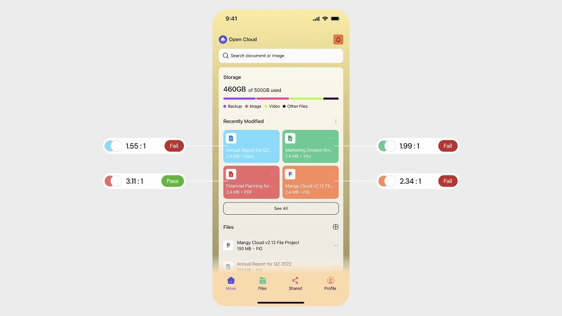
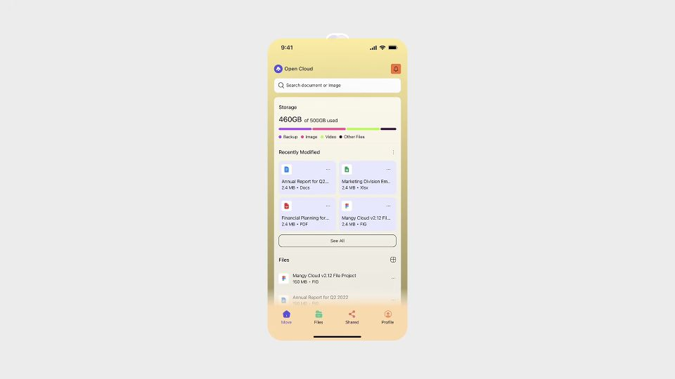

# Quiet the repeated card surfaces

Based on Kole Jain’s UX/UI tutorials. These are unofficial, AI-assisted study notes and adapted skills; they were not written, approved or endorsed by Kole Jain. Permission has not been obtained from him.

The source videos, narration and source-frame excerpts remain the content of Kole Jain and any other respective rights holders. They are not licensed by this project.

Source-video comparison, not a controlled usability experiment.

[Kole Jain — The 7 Color Mistakes that RUIN your UI Designs](https://www.youtube.com/watch?v=EOcY3hPMQkk)

## Problem shown · 0:24

The four cards use different fills and pale labels. The Pass/Fail badges are the creator’s annotations, not measurements by this library.

[Open public image](https://brianjmeier.github.io/design-fieldnotes/assets/examples/color-problem-24.jpg) · [Watch this moment in Kole Jain’s original video](https://www.youtube.com/watch?v=EOcY3hPMQkk&t=24s)

## Change shown · 1:05

Repeated card surfaces now match; colored file-type icons and the yellow surrounding app remain.

[Open public image](https://brianjmeier.github.io/design-fieldnotes/assets/examples/color-revision-65.jpg) · [Watch this moment in Kole Jain’s original video](https://www.youtube.com/watch?v=EOcY3hPMQkk&t=65s)

## Problem

Four file cards use different saturated fills and pale labels, creating competing accents.

## Observed change

The same grid uses a shared pale lavender surface and dark labels; file-type icons retain color.

## Interpreted mechanism

Quieter repeated surfaces let labels and type markers carry the distinction.

## Transfer when

Repeated content has equal priority and color has no separate status meaning.

## Limits and counterexamples

Do not remove useful brand or status color. Camera scale differs; compare color roles, not apparent type size. The displayed 3.11:1 Pass does not establish WCAG AA for normal-size text.

## Unverified outcomes

No contrast ratio, usability or task outcome was independently measured.

## Provenance

Browser screenshot of the full 960 × 540 official embedded player, sought with the documented YouTube IFrame API; paused, player controls hidden. No video file download or image retouching.

Captured 2026-10-09. No image edits. Source annotations and any subtitles remain part of the excerpt.

[Source-material rights](../SOURCE-MATERIAL.md)

Use a vision-capable image tool to load both local images or public image URLs. Text links and alt text alone do not provide the visual evidence.
